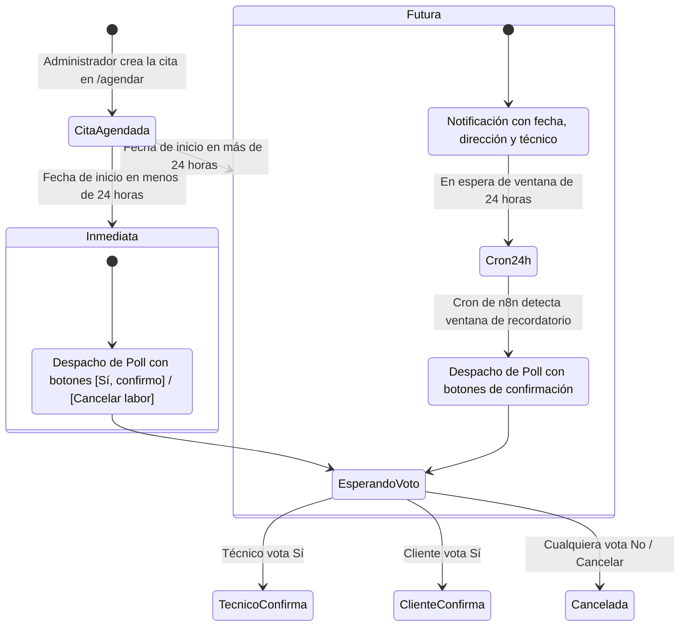
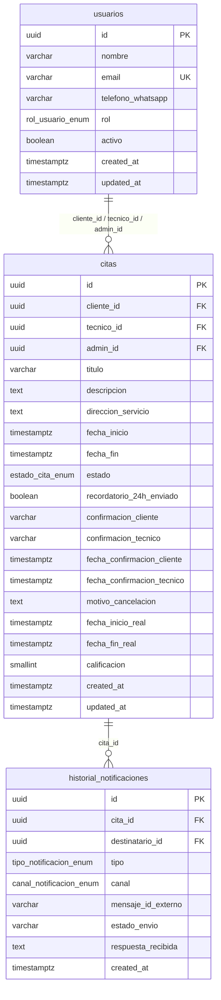

# 📅 Sistema Integral de Agendamiento y Notificaciones WhatsApp

[](docker-compose.yml)
[](init-db/01-init.sql)
[](workflows/n8n_citas_workflow.json)
[](https://waha.devlike.pro/)
[](meta_bridge.py)
[](https://tailscale.com)

Plataforma empresarial de agendamiento de citas, coordinación técnica y confirmación interactiva automatizada a través de WhatsApp. Diseñada con arquitectura de microservicios contenerizada sobre Docker, orquestada con **n8n**, base de datos relacional **PostgreSQL**, pasarela WhatsApp Web (**WAHA**) y un portal web administrativo con autenticación de sesiones y resolución inteligente de encuestas interactivas.

---

## 📑 Tabla de Contenidos

- [Arquitectura del Sistema](#-arquitectura-del-sistema)
- [Características Principales](#-características-principales)
- [Estructura del Repositorio](#-estructura-del-repositorio)
- [Requisitos Previos](#-requisitos-previos)
- [Puesta en Marcha Rápida](#-puesta-en-marcha-rápida)
- [Variables de Entorno (.env)](#-variables-de-entorno-env)
- [Portal Web y Módulos](#-portal-web-y-módulos)
- [Flujo Inteligente de Notificaciones WhatsApp](#-flujo-inteligente-de-notificaciones-whatsapp)
- [Resolución de Privacidad LID de WhatsApp](#-resolución-de-privacidad-lid-de-whatsapp)
- [Esquema de Base de Datos](#-esquema-de-base-de-datos)
- [Automatización con n8n](#-automatización-con-n8n)
- [Acceso Público Seguro con Tailscale Funnel](#-acceso-público-seguro-con-tailscale-funnel)
- [Mantenimiento y Utilidades](#-mantenimiento-y-utilidades)
- [Licencia](#-licencia)

---

## 🏛 Arquitectura del Sistema

```mermaid
flowchart TD
    subgraph Internet ["🌐 Acceso Seguro Externo"]
        ClientUser["👤 Cliente / Administrador"] -->|HTTPS| Funnel["🛡️ Tailscale Funnel (SSL)"]
    end

    subgraph Host ["🖥️ Servidor Docker Host"]
        Funnel -->|Puerto 8088| MetaBridge["🐍 Meta Bridge Webhook & Web UI\n(FastAPI / Python 3.11)"]

        subgraph Containers ["📦 Servicios Docker"]
            MetaBridge -->|Query / Insert / Update| Postgres[("🐘 PostgreSQL 16\ncitas_db (Puerto 5433:5432)")]
            MetaBridge -->|HTTP Trigger Webhook| n8n["⚙️ n8n Workflow Engine\n(Puerto 403:5678)"]
            n8n -->|Consultas SQL & Cron| Postgres
            n8n -->|POST /api/sendPoll & /api/sendText| WAHA["💬 WAHA (WhatsApp HTTP API)\n(Puerto 3000)"]
            WAHA -->|Webhook Inbound (message, poll.vote)| MetaBridge
        end
    end

    subgraph WhatsAppCloud ["📱 Red WhatsApp"]
        WAHA <-->|WebJS Engine| Devices["📲 WhatsApp Clientes, Técnicos y Administradores"]
    end
```

---

## ✨ Características Principales

- **Portal Web Integrado (`/agendar`):**
  - Formulario de agendamiento con validación de horarios y selección de cliente, técnico y administrador organizador.
  - Tabla de control y seguimiento de citas con filtros en tiempo real (por estado, rango de fechas, cliente o técnico).
  - Generación y descarga directa de invitaciones de calendario en formato estándar **`.ics`** (compatible con Google Calendar, Apple Calendar y Outlook).
  - Exportación de reportes de auditoría y citas en formato **Excel (`.xlsx`)** con filtros activos.
- **Gestión de Sesión WhatsApp Web (`/agendar/whatsapp`):**
  - Panel visual para escaneo de código QR en vivo sin reiniciar contenedores.
  - Detección automática del estado de la sesión (`SCAN_QR_CODE`, `WORKING`, `STOPPED`).
  - Botón de **Reconexión Segura (Sin QR)** para restaurar la sesión ante microcortes.
  - Botón de **Desvinculación / Cierre de Sesión** con modal de confirmación obligatoria para evitar desconexiones accidentales.
- **Flujo Inteligente de Notificaciones (< 24h vs. > 24h):**
  - **Citas agendadas a menos de 24 horas:** Despacho inmediato de encuesta interactiva con botones de confirmación (`[✅ Sí, confirmo]` / `[❌ Cancelar labor]`) tanto al cliente como al técnico.
  - **Citas agendadas a más de 24 horas:** Notificación informativa preliminar inmediata; el envío de la encuesta interactiva con botones se difiere automáticamente para ejecutarse exactamente 24 horas antes de la labor mediante cron en n8n.
- **Presupuesto Dinámico de Caracteres en WhatsApp Polls:**
  - Control algorítmico estricto para no superar el límite de **255 caracteres** impuesto por WhatsApp en `poll.name`. Asignación dinámica entre título del servicio, nombres y dirección para evitar errores `400 Bad Request`.
- **Traducción Automática de WhatsApp LIDs:**
  - WhatsApp Multi-Device oculta los números telefónicos en las votaciones enviando identificadores opacos `@lid` (ej. `158488755966096@lid`). Meta Bridge consulta en tiempo real a WAHA (`/api/default/lids/:lid`) para resolver el número internacional real, actualizar la base de datos y notificar al administrador.
- **Notificaciones Multi-Rol en Tiempo Real:**
  - Alerta instantánea vía WhatsApp al administrador ante cualquier voto emitido por el cliente o técnico, reflejando el nuevo estado de la cita.

---

## 📁 Estructura del Repositorio

```text
.
├── docker-compose.yml              # Orquestación de contenedores (Postgres, n8n, Meta Bridge, WAHA)
├── .env.example                    # Plantilla de variables de entorno seguras
├── .gitignore                      # Reglas de exclusión para credenciales, logs y temporales
├── meta_bridge.py                  # Servidor web, UI de agendamiento, panel QR y resolución de webhooks
├── README.md                       # Documentación técnica completa
├── init-db/
│   └── 01-init.sql                 # Esquema DDL de PostgreSQL (Tablas, ENUMs, triggers e índices)
├── workflows/
│   └── n8n_citas_workflow.json     # Flujo visual exportado de n8n para agendamiento y recordatorios
└── scripts/                        # Utilidades y herramientas de mantenimiento
    ├── README.md                   # Documentación de scripts auxiliares
    ├── apply_dynamic_character_budget.py
    ├── apply_smart_scheduling_flow.py
    ├── update_admin_phone_everywhere.py
    └── upgrade_multi_admin.py
```

---

## 🔧 Requisitos Previos

1. **Docker y Docker Compose:**
   - Docker Engine versión 24.0 o superior.
   - Docker Compose V2 (`docker compose`).
2. **Sistema Operativo:**
   - Distribución Linux basada en Debian/Ubuntu (o cualquier entorno POSIX compatible).
3. **Puertos Libres en el Host:**
   - `5433`: PostgreSQL (mapeado para evitar colisión con Postgres local `5432`).
   - `403`: n8n Automation Editor.
   - `8088`: Meta Bridge Web UI & Webhooks.
   - `3000`: WAHA (vinculado a `127.0.0.1` por seguridad).

---

## 🚀 Puesta en Marcha Rápida

### 1. Clonar el repositorio
```bash
git clone https://github.com/DanielCortes16/SistemaDeAgendamiento.git
cd SistemaDeAgendamiento
```

### 2. Configurar variables de entorno
Copia la plantilla y ajusta tus credenciales:
```bash
cp .env.example .env
nano .env
```

### 3. Levantar los contenedores
```bash
docker compose up -d
```

Verifica que todos los servicios estén en estado saludable (`healthy` o `running`):
```bash
docker compose ps
```

### 4. Vincular WhatsApp Web
1. Abre en tu navegador el portal de vinculación:
   `http://<IP-DE-TU-SERVIDOR>:8088/agendar/whatsapp`
2. Inicia sesión con las credenciales de administrador configuradas.
3. Escanea el código QR con el WhatsApp de la empresa (**Dispositivos vinculados > Vincular un dispositivo**).
4. El estado cambiará automáticamente a `WORKING` en verde.

### 5. Importar el Flujo de Trabajo en n8n
1. Ingresa a n8n en `http://<IP-DE-TU-SERVIDOR>:403`.
2. Ve a **Workflows** > **Add Workflow** (`+`).
3. En el menú superior derecho (`...`), haz clic en **Import from File**.
4. Selecciona el archivo [`workflows/n8n_citas_workflow.json`](workflows/n8n_citas_workflow.json).
5. Configura la credencial de **PostgreSQL** interna de n8n:
   - **Host:** `postgres`
   - **Database:** `citas_db` (o el valor de `POSTGRES_DB`)
   - **User:** `citas_admin` (o el valor de `POSTGRES_USER`)
   - **Password:** Tu contraseña configurada en `.env`
   - **Port:** `5432`
   - **SSL:** `disable`
6. Activa el flujo activando el interruptor **Active** en la esquina superior derecha.

---

## 🔐 Variables de Entorno (.env)

El archivo `.env` controla los secretos de la infraestructura. Nunca debe subirse al control de versiones:

| Variable | Descripción | Valor por Defecto / Ejemplo |
| :--- | :--- | :--- |
| `GENERIC_TIMEZONE` / `TZ` | Zona horaria para servidor, n8n y Postgres | `America/Bogota` |
| `POSTGRES_USER` | Usuario de la base de datos | `citas_admin` |
| `POSTGRES_PASSWORD` | Contraseña de PostgreSQL | *Clave segura* |
| `POSTGRES_DB` | Nombre de la base de datos | `citas_db` |
| `POSTGRES_HOST_PORT` | Puerto expuesto en el host para PostgreSQL | `5433` |
| `N8N_HOST_PORT` | Puerto expuesto en el host para n8n | `403` |
| `N8N_ENCRYPTION_KEY` | Llave criptográfica de 32 caracteres para credenciales en n8n | *Cadena aleatoria 32 chars* |
| `WAHA_API_KEY` | Token secreto de autenticación para la API de WAHA | `citas-waha-key-2026` |
| `ADMIN_WHATSAPP_NUMBER` | Teléfono internacional del administrador para recibir alertas | `+573118198511` |

---

## 🖥 Portal Web y Módulos

El backend de `meta_bridge.py` sirve una interfaz web reactiva, intuitiva y optimizada para dispositivos móviles:

### 1. Panel de Agendamiento y Listado (`/agendar`)
- **Agendar Cita:** Selección de cliente, técnico responsable, administrador asignado, título de labor, dirección y selector de fecha/hora con validaciones de congruencia.
- **Buscador & Filtros:** Permite filtrar instantáneamente por texto de cliente, técnico, estado de la cita (`PENDIENTE`, `CONFIRMADA`, `CANCELADA`, `EN_PROGRESO`, `COMPLETADA`) o rango de fechas.
- **Acciones Rápidas:**
  - Descargar invitación `.ics`.
  - Cancelar o reagendar cita.
  - Eliminar registros con confirmación modal.

### 2. Exportación a Excel (`/agendar/exportar`)
Descarga un archivo `.xlsx` estructurado con la totalidad de campos requeridos para reportería y métricas de desempeño técnico:
- ID Cita, Labor, Fecha Inicio/Fin, Datos de Cliente, Datos de Técnico, Estado y Registro de Confirmaciones individuales.

### 3. Centro de Conexión WhatsApp (`/agendar/whatsapp`)
- Visualización del número actualmente vinculado (ej. `+57 311 819 8511`).
- Monitor de latencia y estado de sesión.
- Generación de QR dinámico a petición.
- Recuperación de sesión tras desconexiones de red.

---

## ⚡ Flujo Inteligente de Notificaciones WhatsApp

El sistema implementa una lógica de dos vías según la inmediatez de la cita:



### Presupuesto Dinámico de Caracteres en Encuestas
WhatsApp impone una restricción innegociable de **255 caracteres** en el nombre de la encuesta (`poll.name`). Para evitar que direcciones extensas o nombres largos descarten el envío del mensaje:
- El texto base fijo se compacta a ~55 caracteres.
- Se calculan los caracteres libres restantes (~190 caracteres).
- Se reparte el presupuesto dinámicamente:
  - Título del servicio: máximo 50 caracteres.
  - Nombre del cliente: máximo 25 caracteres.
  - Dirección del servicio: truncada dinámicamente para que la suma total sea siempre inferior o igual a 245 caracteres.

---

## 🔍 Resolución de Privacidad LID de WhatsApp

En las versiones modernas de WhatsApp Web / Multi-Device, cuando un usuario presiona una opción en una encuesta interactiva, el evento emitido no contiene su número telefónico `@c.us`, sino un identificador de privacidad opaco:
```json
{
  "event": "poll.vote",
  "payload": {
    "vote": {
      "from": "158488755966096@lid",
      "selectedOptions": ["✅ SÍ, CONFIRMO"]
    }
  }
}
```

### Mecanismo de Resolución en `meta_bridge.py`:
1. El webhook intercepta el campo `@lid`.
2. Invoca internamente el endpoint de WAHA `GET /api/default/lids/{lid}`.
3. Obtiene el número en formato internacional normalizado (ej. `+573154569189`).
4. Consulta la base de datos PostgreSQL para identificar si el votante es el **Cliente** o el **Técnico**.
5. Actualiza la columna correspondiente (`confirmacion_cliente` o `confirmacion_tecnico`).
6. Si ambos confirman, la cita transiciona automáticamente a estado `CONFIRMADA`.
7. **Inicio de Labor:** Al alcanzar el estado `CONFIRMADA`, se despacha automáticamente una encuesta interactiva al técnico con la opción `[▶️ Iniciar Labor]`.
8. **Ejecución en Progreso:** Al presionar `[▶️ Iniciar Labor]`, se registra `fecha_inicio_real = NOW()`, el estado pasa a `EN_PROGRESO`, se notifica al cliente que el técnico comenzó labores, se avisa al administrador y se le envía al técnico el botón `[⏹️ Finalizar Labor]`.
9. **Finalización de Labor:** Al culminar el trabajo y presionar `[⏹️ Finalizar Labor]`, se registra `fecha_fin_real = NOW()`, el estado pasa a `COMPLETADA`, se computa la duración real exacta (`Xh Ym`), se confirma al técnico, se notifica al administrador y se envía automáticamente la encuesta de satisfacción CSAT al cliente.
10. **Calificación CSAT (1 a 5 ⭐):** El cliente recibe una encuesta interactiva en WhatsApp con opciones de 1 a 5 estrellas (`⭐ 5 - Excelente` a `⭐ 1 - Muy Malo`). Al emitir su voto, se registra en la base de datos, se agradece al cliente y se notifica al administrador (disparando una alerta prioritaria roja si el puntaje es de 1 o 2 estrellas para atención de garantías y control de calidad).

---

## 🗄 Esquema de Base de Datos

El archivo [`init-db/01-init.sql`](init-db/01-init.sql) inicializa un esquema relacional optimizado:



---

## 🌐 Acceso Público Seguro con Tailscale Funnel

Para exponer el portal administrativo y los webhooks a internet sin abrir puertos en el router ni configurar IP pública fija:

1. Configura **Tailscale** en la máquina anfitriona:
   ```bash
   sudo tailscale up
   ```
2. Habilita Tailscale Funnel apuntando al puerto de Meta Bridge (`8088`):
   ```bash
   tailscale funnel 8088 on
   ```
3. Tu sistema estará disponible en una URL HTTPS pública protegida por certificado Let's Encrypt automático:
   `https://<tu-nodo>.tailscale.net/agendar`

---

## 🛠 Mantenimiento y Utilidades

En la carpeta [`scripts/`](scripts/) se encuentran herramientas para diagnósticos y migraciones directas:
- **`apply_dynamic_character_budget.py`**: Aplica en caliente los algoritmos de presupuesto de caracteres en las expresiones JavaScript de n8n.
- **`update_admin_phone_everywhere.py`**: Actualiza de forma segura el teléfono del administrador en todas las capas del sistema.
- **`upgrade_multi_admin.py`**: Verifica y migra el esquema para soportar múltiples administradores coordinadores.

Para consultar los logs en vivo de los servicios:
```bash
# Logs del puente de webhooks y portal web
docker compose logs -f meta_bridge

# Logs del motor n8n
docker compose logs -f n8n

# Logs de la pasarela WAHA
docker compose logs -f waha
```

---

## 📄 Licencia

Este proyecto se encuentra desarrollado para uso empresarial bajo la licencia MIT. Consulta el archivo `LICENSE` para más información.
